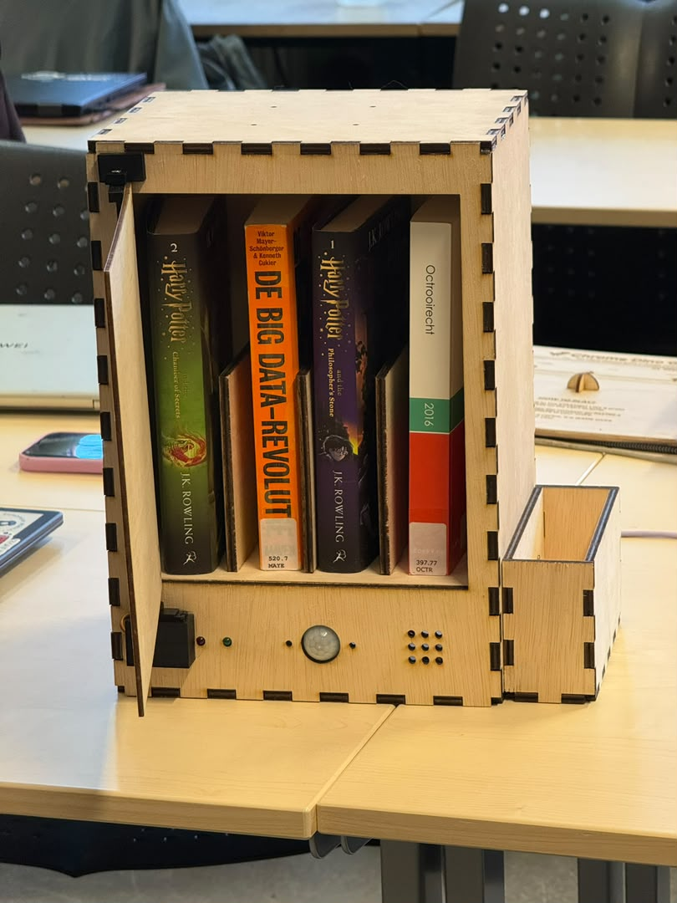
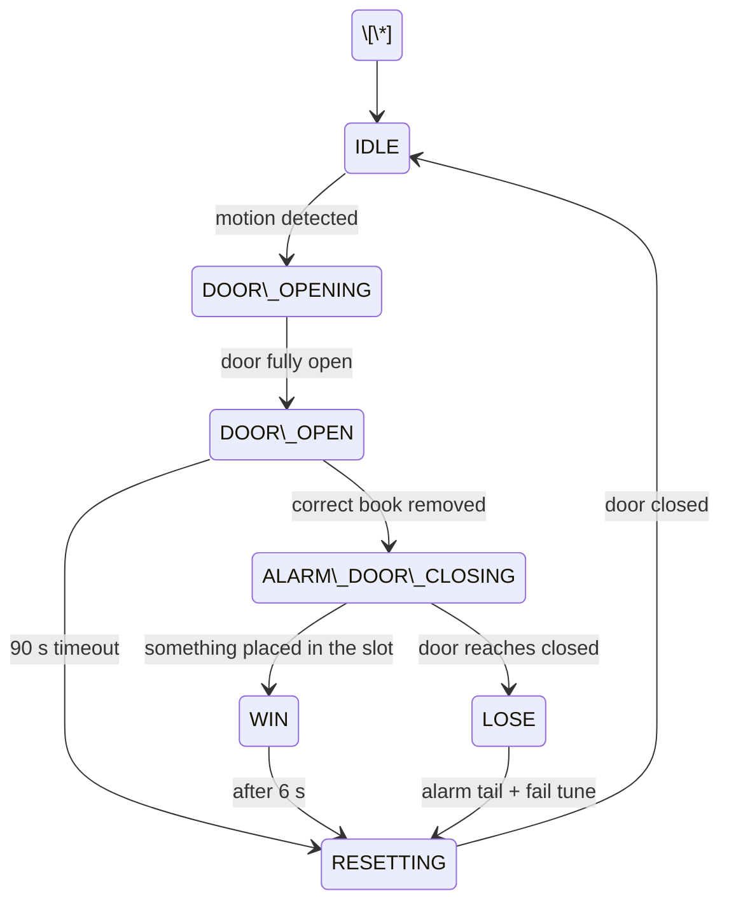

# 🧙 The Harry Potter Bookcase

**An interactive Arduino escape-room project: find the right book and swap it out before the door shuts.**

A motion sensor notices when you reach toward the bookcase, and a servo slowly swings the door open. Inside are several books, but only one is the right one, and nothing tells you which. Pull out the right book and an alarm goes off while the door starts creeping shut. To win, grab the decoy book from the holder beside the case and drop it into the empty slot before the door closes.

The finished bookcase:

Link to video run-through: https://youtu.be/2EO7bslizVw 

\---

## ✨ Features

* **Hands-free start:** a PIR sensor triggers the game as soon as someone approaches.
* **Two-stage door reveal:** the door opens partway, pauses, then opens fully for a bit of suspense.
* **One sensor-equipped slot:** only the right book's slot is wired, so the other books are just props and the player has to find the right one by trial.
* **Race against the door:** the door closes over about 18 seconds while a two-tone siren plays and the red LED flashes.
* **Win and lose endings:** a rising melody and a green LED for a win; a falling melody and a solid red LED for a loss.
* **Resets itself:** after every round the prop returns to idle with no one needing to touch it, so the next person can just walk up and play.
* **Non-blocking firmware:** a `millis()`-based state machine runs the door, sound, LEDs and sensors at the same time, with no `delay()` in the game loop.

\---

## 🎮 How a round plays out

|State|What happens|
|-|-|
|`IDLE`|Door closed, LEDs off, waiting for motion. Motion is ignored for 3 s after a reset.|
|`DOOR\\\_OPENING`|Door opens to a partial angle, pauses 2 s, then opens fully.|
|`DOOR\\\_OPEN`|Waiting for the player to pull out the right book. Gives up and resets after 90 s.|
|`ALARM\\\_DOOR\\\_CLOSING`|Siren plays, red LED flickers, door closes 1° every 200 ms.|
|`WIN`|Success melody, green LED, door reopens as a reward.|
|`LOSE`|Siren keeps going for 2 s, then a fail melody plays with a solid red LED.|
|`RESETTING`|Door returns to closed and the game goes back to `IDLE`.|

### Design details

* **Arming:** the game only arms when the slot is occupied while the door is open. If the slot was left empty after a lost round, the next player just has to put a book back to start a new round. An empty slot can't trigger a false alarm.
* **Presence, not weight:** the slot sensor only checks whether *something* is in the slot. It doesn't try to tell the real book from the decoy, which keeps the sensor reliable and needs no calibration.
* **One trigger per player:** after a reset, the PIR output has to go LOW before a new trigger counts, so someone still standing in front of the case won't keep reopening the door.
* **Debounced inputs:** the slot reading must hold for 250 ms before it counts, so a wobbling book doesn't cause a false win or a false alarm. The PIR signal must stay HIGH for 100 ms to filter glitches.
* **Safe door:** the door moves one degree at a time and closes slowly, because it's a moving part near people's hands.

\---

## 🔧 Hardware

|Component|Purpose|
|-|-|
|Arduino Uno R4 WiFi|Main controller (WiFi not used)|
|PIR motion sensor|Detects a player approaching|
|Micro lever switch|Detects whether the correct book's slot is occupied|
|Servo MG90S 180 degrees|Opens and closes the door|
|Passive piezo buzzer|Siren, success and fail tunes|
|Green and red LEDs + resistors|Win / lose / alarm feedback|

### Wiring

|Signal|Arduino pin|Notes|
|-|-|-|
|PIR output|`A1`||
|Slot switch|`A0`||
|Servo signal|`D9`||
|Green LED|`D5`||
|Red LED|`D6`||
|Buzzer|`D3`||

\---

## 🪵 Physical build

* **Laser-cut panels** for the case: front panel with a door cutout, sides, back, shelf, door hinge support, and a holder for the decoy book.
* **3D-printed parts:** brick and trim details, the sorting-hat-style topper (decoration only), servo mount, sensor tray for the book slot, and an electronics tray.

All laser cut files can be found in the `/lasercut` folder, and all 3D print files can be found in the `/3dprint` folder.

\---

### Getting started

1. Install the [Arduino IDE](https://www.arduino.cc/en/software) and add the **Arduino UNO R4 Boards** package through the Boards Manager.
2. Clone this repository and open `HarryPotterBookcase/HarryPotterBookcase.ino`. The folder name must match the main sketch's name so the IDE loads all the tabs.
3. Select **Arduino UNO R4 WiFi** and the right port.
4. Upload. The only library used is `Servo`, which comes with the IDE.
5. Open the Serial Monitor at **115200 baud** to follow state changes and sensor readings.

> The PIR sensor needs about \\\*\\\*30 seconds to warm up\\\*\\\* after power-on. Motion is ignored during that time. Both LEDs light briefly at boot as a self-test.

### Tuning

Every pin, threshold, angle and timing is a named constant at the top of `HarryPotterBookcase.ino`, so the experience can be tuned without touching the logic.

|Constant|Default|What it controls|
|-|-|-|
|`DOOR\\\_CLOSED\\\_ANGLE` / `DOOR\\\_PARTIAL\\\_ANGLE` / `DOOR\\\_OPEN\\\_ANGLE`|180° / 140° / 90°|Servo positions|
|`DOOR\\\_OPEN\\\_STEP\\\_MS`|25 ms/°|Opening speed|
|`DOOR\\\_PARTIAL\\\_PAUSE\\\_MS`|2000 ms|Suspense pause halfway open|
|`DOOR\\\_CLOSE\\\_STEP\\\_MS`|200 ms/°|Closing speed during the alarm (≈ 18 s to close)|
|`DOOR\\\_OPEN\\\_TIMEOUT\\\_MS`|90 s|How long the door stays open if nobody plays|
|`PIR\\\_ANALOG\\\_THRESHOLD`|400|Analog level counted as "motion"|
|`SLOT\\\_DEBOUNCE\\\_MS`|250 ms|How stable the slot reading must be|
|`SIREN\\\_HIGH\\\_HZ` / `SIREN\\\_LOW\\\_HZ`|1200 / 800 Hz|Siren tones|
|`WIN\\\_HOLD\\\_MS` / `LOSE\\\_HOLD\\\_MS`|6 s / 5 s|How long each ending is shown|

Set `DEBUG\\\_SERIAL` to `0` to compile out all serial logging.

## 📜 Disclaimer

This is a non-commercial fan project. Harry Potter is a trademark of Warner Bros. Entertainment Inc.; this project is not affiliated with or endorsed by its owners.

